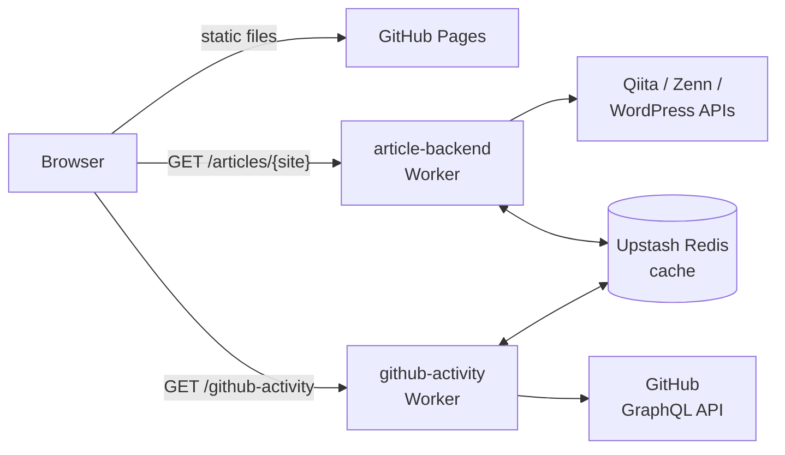

# Kudoma Portfolio

<https://www.kudoma.net> で公開している個人のポートフォリオサイト。ライトとダークの 2 つのテーマがある。1 ページに、About、Skills、Experiences、Products、Blog（Qiita・Zenn・自分のテックブログの記事）、GitHub（ピン留めリポジトリと直近のコントリビューション）の 6 つのセクションがある。

## 技術スタック

- **サイト**: React、TypeScript、MUI（Emotion）。Vite でビルドして、GitHub Pages で公開
- **バックエンド**: Cloudflare Workers が 2 つ（`workers/`）。記事と GitHub のデータを取得して整形し、Upstash Redis のリードスルーキャッシュを持つ
- **テストと lint**: Jest（ts-jest）と ESLint。Workers には、`node:test` の専用のテストがある
- **CI/CD**: GitHub Actions。依存の更新は Dependabot

## システム構成



ブラウザはキャッシュを持たず、キャッシュは Worker が持つ（成功は 1 時間、上流の失敗は 60 秒）。詳しくは [`workers/README.md`](workers/README.md) を参照。

## 開発を始める

Node.js のバージョンは [`.node-version`](.node-version) で固定していて、CI も同じものを使う。[fnm](https://github.com/Schniz/fnm) なら、このディレクトリで `fnm use` を実行すると合わせられる（シェルの設定に `eval "$(fnm env --use-on-cd)"` を書くと、自動で切り替わる）。

```bash
npm ci
npm start        # 開発サーバー（Vite。既定では http://localhost:5173）
```

サイトは、Worker の URL を `.env`（`VITE_ARTICLE_BASE_URL`、`VITE_GITHUB_ACTIVITY_BASE_URL`）から読む。これはデプロイ済みの Worker を指しているので、ローカルの開発サーバーでも、実際の記事と GitHub のデータが表示される。別の値を使いたいときは、`.env.local`（Git の管理外）に書く。

### コマンド

| コマンド | 内容 |
| --- | --- |
| `npm start` | 開発サーバー |
| `npm run build` | 型チェック（`tsc --noEmit`）のあと、`build/` に本番ビルド |
| `npm run preview` | ビルドした `build/` をローカルで配信 |
| `npm run lint` | `src` に対する ESLint |
| `npm test` | `tests/` に対する Jest |
| `npx jest tests/service/ArticleService.spec.ts` | 1 つのテストファイルだけを実行（1 つのテストだけなら `-t "名前"` を追加） |

Workers は別のパッケージ: `npm ci --prefix workers` のあと、`npm run typecheck --prefix workers` と `npm test --prefix workers`。

## ディレクトリ構成

| パス | 内容 |
| --- | --- |
| `src/` | サイト本体。`App.tsx` が `components/` からページを組み立てる。`theme.ts` に MUI のテーマとデザイントークン、`service/` に Worker からデータを取得する処理、`env.ts` に `VITE_*` の読み込み |
| `src/data/` | 静的なコンテンツ（経歴・プロダクト・スキル）。**内容を変えるときは、コンポーネントではここを編集する** |
| `tests/` | サイトの Jest のテスト（`fetch` をモックしているので、ネットワークは呼ばない） |
| `workers/` | Cloudflare Workers（`article-backend`、`github-activity`） |
| `public/` | そのままビルドにコピーされるファイル（`CNAME`、favicon、`robots.txt`、`sitemap.xml` など） |
| `.github/` | ワークフローと Dependabot の設定 |

## CI/CD

- **プルリクエスト**では `ci.yml`（`lint-and-test`: lint、Jest、Workers の型チェック）が走る。`main` は保護されていて、変更は PR で行い、`lint-and-test` が通る必要がある。
- **`main` にマージ**すると、サイトが GitHub Pages にデプロイされる（`deploy.yml`）。Worker は、そのディレクトリが変わったときだけ（`deploy-article-backend.yml`、`deploy-github-activity.yml`）、または手動でワークフローを実行したときにデプロイされる。デプロイの結果は、`SLACK_WEBHOOK_URL` が設定されていれば Slack に通知される。
- **Dependabot** が、毎週月曜（JST）に、サイト・`workers/`・GitHub Actions のグループ化した PR を作る。`.node-version` の Node のバージョンと、Worker のデプロイのワークフローに固定した `wrangler` のバージョンは追えないので、手で上げる。サイトの `typescript` の major 更新は、今は ignore している（`.github/dependabot.yml` を参照）。

## そのほかのドキュメント

- [`workers/README.md`](workers/README.md): Worker、その環境変数、デプロイの方法
- [`CLAUDE.md`](CLAUDE.md): アーキテクチャのメモと規約（Claude Code 向けに書いているが、誰にとっても参考になる）
