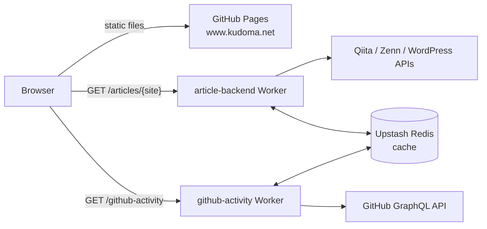

# Kudoma Portfolio

Personal portfolio site at <https://www.kudoma.net>, with a light and a dark theme. A single page with six sections: About, Skills, Experiences, Products, Blog (articles from Qiita, Zenn and the author's tech blog) and GitHub (pinned repositories and recent contributions).

## Tech stack

- **Site**: React, TypeScript, MUI (Emotion), built with Vite and hosted on GitHub Pages
- **Backend**: two Cloudflare Workers (`workers/`) that fetch and normalize the article and GitHub data, with a read-through cache in Upstash Redis
- **Tests and lint**: Jest (ts-jest) and ESLint; the Workers have their own `node:test` tests
- **CI/CD**: GitHub Actions; dependencies are updated by Dependabot

## System Architecture




The browser does not cache anything itself; the Workers own the cache (1 hour on success, 60 seconds on an upstream failure). Details are in [`workers/README.md`](workers/README.md).

## Getting started

The Node.js version is pinned in [`.node-version`](.node-version) and used by CI. With [fnm](https://github.com/Schniz/fnm), `fnm use` in this directory picks it up (or run `eval "$(fnm env --use-on-cd)"` in your shell profile to switch automatically).

```bash
npm ci
npm start        # dev server (Vite, http://localhost:5173 by default)
```

The site reads the Worker URLs from `.env` (`VITE_ARTICLE_BASE_URL`, `VITE_GITHUB_ACTIVITY_BASE_URL`), which point at the deployed Workers, so a local dev server shows real articles and GitHub data. To use other values, put them in `.env.local` (git-ignored).

### Commands

| Command | What it does |
| --- | --- |
| `npm start` | Dev server |
| `npm run build` | Type-check (`tsc --noEmit`), then a production build into `build/` |
| `npm run preview` | Serve the built `build/` locally |
| `npm run lint` | ESLint over `src` |
| `npm test` | Jest over `tests/` |
| `npx jest tests/service/ArticleService.spec.ts` | One test file (add `-t "name"` for one test) |

The Workers are a separate package: `npm ci --prefix workers`, then `npm run typecheck --prefix workers` and `npm test --prefix workers`.

## Project layout

| Path | Contents |
| --- | --- |
| `src/` | The site. `App.tsx` composes the page from `components/`; `theme.ts` holds the MUI theme and design tokens; `service/` fetches data from the Workers; `env.ts` reads the `VITE_*` variables |
| `src/data/` | Static content (experiences, products, skills). **Edit content here** rather than in the components |
| `tests/` | Jest tests for the site (`fetch` is mocked, so they make no network calls) |
| `workers/` | The Cloudflare Workers (`article-backend`, `github-activity`) |
| `public/` | Files copied as they are into the build (`CNAME`, favicons, `robots.txt`, `sitemap.xml`, ...) |
| `.github/` | Workflows and Dependabot configuration |

## CI/CD

- **Pull requests** run `ci.yml` (`lint-and-test`: lint, Jest, and the Workers type check). `main` is protected: changes go through a pull request and `lint-and-test` must pass.
- **Merging to `main`** deploys the site to GitHub Pages (`deploy.yml`). A Worker is deployed only when its own directory changes (`deploy-article-backend.yml`, `deploy-github-activity.yml`), or by running the workflow manually. Deploy results are posted to Slack when `SLACK_WEBHOOK_URL` is set.
- **Dependabot** opens grouped pull requests every Monday (JST) for the site, `workers/` and GitHub Actions. It cannot track the Node version in `.node-version` or the `wrangler` version pinned in the Worker deploy workflows, so bump those by hand. Major updates of the site's `typescript` are ignored for now (see `.github/dependabot.yml`).

## More documentation

- [`workers/README.md`](workers/README.md): the Workers, their environment variables and how to deploy them
- [`CLAUDE.md`](CLAUDE.md): architecture notes and conventions (written for Claude Code, useful for anyone)
